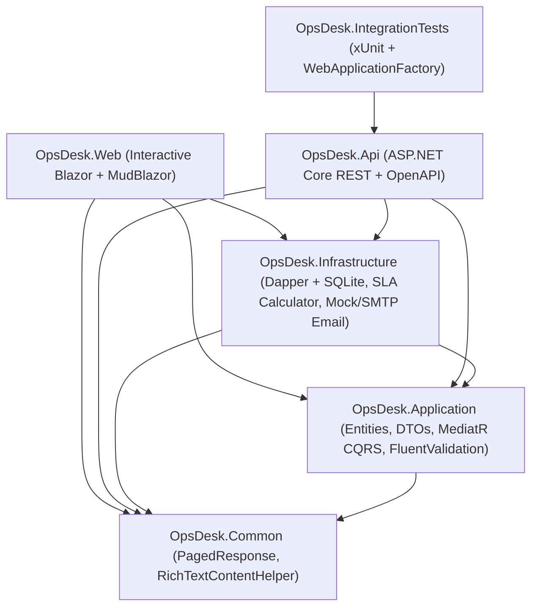
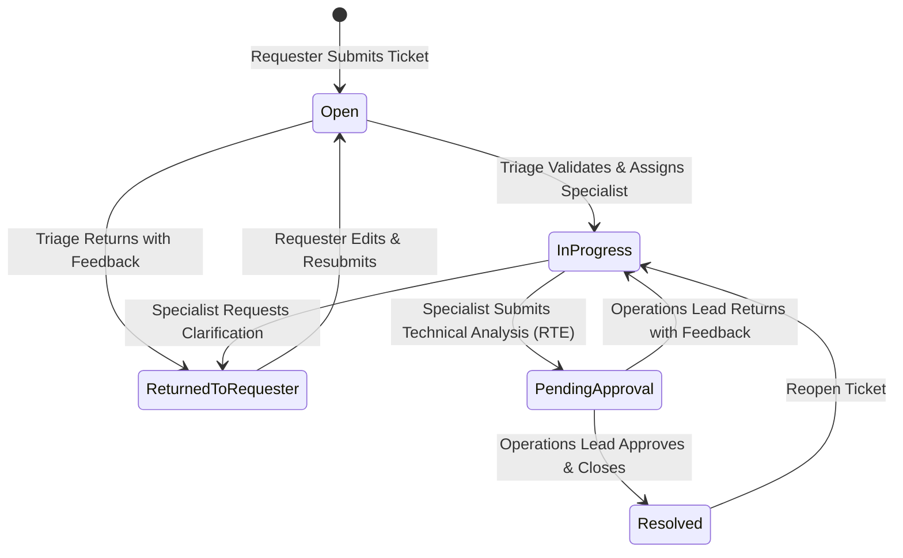
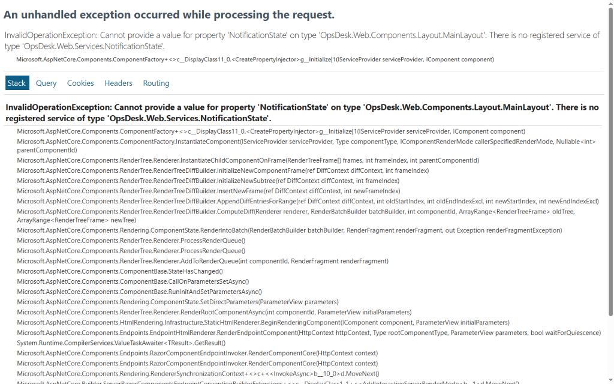
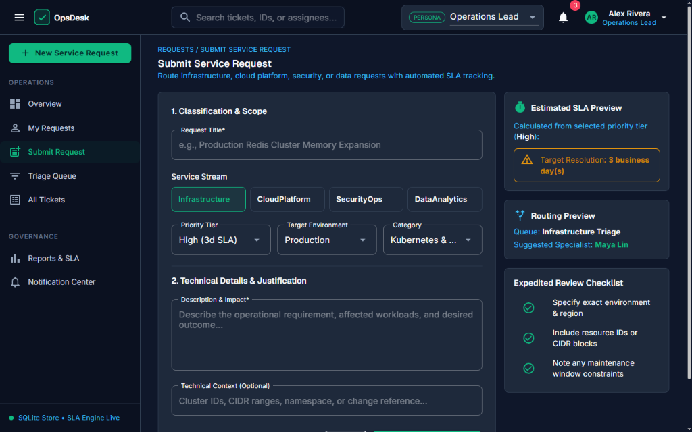
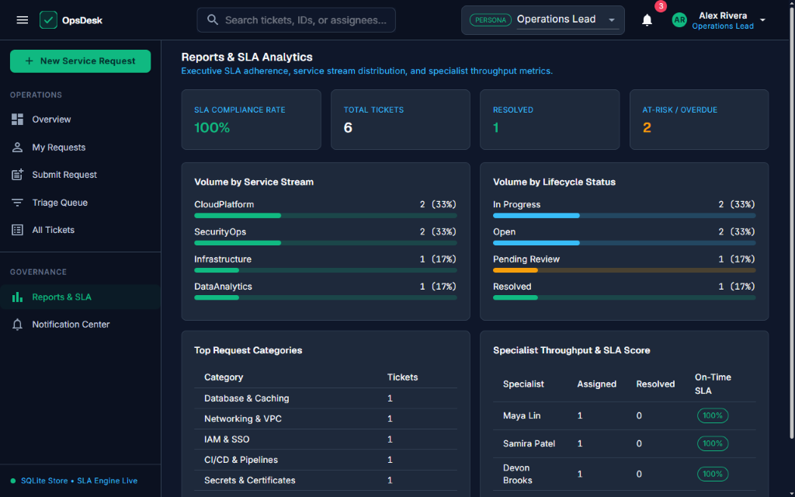

# OpsDesk

Enterprise IT & Operations Service Desk platform built with **.NET 10**, **Clean Architecture**, **DDD**, **CQRS (MediatR)**, **Dapper + SQLite**, and **MudBlazor** (`Obsidian & Emerald` theme).

---

## Architecture Overview



### Unified Ticket State Machine

All service requests are managed through a single unified `Ticket` entity (`OPS-2041`) across its full lifecycle:



### Key Patterns & Design Highlights
- **Unified Domain & CQRS Pipeline (`OpsDesk.Application` & `OpsDesk.Common`)**:
  - Single `Ticket` entity enforcing lifecycle transitions (`Open`, `ReturnedToRequester`, `InProgress`, `PendingApproval`, `Resolved`), specialist assignment, threaded messages, internal notes, technical reviews, and cross-team escalations.
  - Command/Query separation via **MediatR** paired with a cross-cutting `ValidationBehavior<TRequest, TResponse>` powered by **FluentValidation**.
  - Shared utilities (`PagedResponse<T>`, `RichTextContentHelper`) in `OpsDesk.Common`.
- **Infrastructure, SLA Engine & Mock/Fake SMTP (`OpsDesk.Infrastructure`)**:
  - Split write (`TicketRepository`) and Dapper read (`TicketQueryRepository`) repositories plus persisted `NotificationRepository` over SQLite.
  - Single consolidated database schema & synthetic seed baseline (`OpsDeskSchemaBaseline`).
  - `BusinessDaySlaCalculator` computing business-day SLA deadlines (`Urgent` = 1 business day, `High` = 3 business days, `Standard` = 7 business days).
  - `SmtpEmailService` + `EmailSettings` with a zero-dependency default **`Mock`** profile alongside preconfigured **`Mailpit` / `Papercut`** (`localhost:1025`) and **`Ethereal`** (`smtp.ethereal.email:587`) fake SMTP profiles.
- **MudBlazor UI & Role-Based Access (`OpsDesk.Web`)**:
  - Dark-mode **Obsidian & Emerald** `MudTheme` (`#0F172A` surface, `#10B981` primary accent, `ROUND_EIGHT` geometry).
  - Live **Persona Switcher** (`Operations Lead`, `Triage Lead`, `Specialist`, `Requester`, `System Admin`) persisted in `localStorage`, paired with `<RoleGuard>` view restrictions and role-filtered navigation.
  - **Quill Rich Text Editor** (`RichTextEditor.razor` + collocated ES module) in the Technical Review workspace, plus `ReturnWithFeedbackDialog` and `TicketClosureDialog` workflow modals.
- **End-to-End Integration Testing (`OpsDesk.IntegrationTests`)**:
  - Isolated SQLite `WebApplicationFactory<Program>` tests verifying submission, business-day SLA calculation, return-to-requester & resubmission, triage routing, specialist assignment, Quill HTML technical review, leader approval & return-to-progress loops, formal resolution, notifications, and analytics reporting.

---

## UI Design (Google Stitch)

The UI was designed in **Google Stitch** using the **OpsDesk — Obsidian & Emerald** design system (`#0F172A` dark slate surface, `#10B981` emerald primary accent, `Geist` / `Inter` typography, `ROUND_EIGHT` geometry):

- **Stitch Project**: [OpsDesk (`projects/12928265875133280844`)](https://stitch.withgoogle.com/projects/12928265875133280844)
- **Design Manifest**: [`.stitch/opsdesk-metadata.json`](.stitch/opsdesk-metadata.json)

| # | Screen | Blazor Route | Stitch Screen |
|---|---|---|---|
| 1 | Operations Overview Dashboard | `/` | [View in Stitch](https://stitch.withgoogle.com/projects/12928265875133280844?screen=e9a6ac8fb02a43ad81f1bb60aed60010) |
| 2 | My Requests — Requester Portal | `/my-requests` | [View in Stitch](https://stitch.withgoogle.com/projects/12928265875133280844?screen=b84dce9dff5d4f5e9d7f252b9c97aec9) |
| 3 | Submit Service Request | `/submit` | [View in Stitch](https://stitch.withgoogle.com/projects/12928265875133280844?screen=70812d88ca05450e8a17a301b2c5ea38) |
| 4 | Triage Queue & Assignment | `/triage` | [View in Stitch](https://stitch.withgoogle.com/projects/12928265875133280844?screen=06d26d5ba20e4df38a45a85080ed5d91) |
| 5 | Ticket Detail & Collaboration Workspace | `/tickets/{id}` | [View in Stitch](https://stitch.withgoogle.com/projects/12928265875133280844?screen=b62e87c1e9714e0ca7984f62fa9a008b) |
| 6 | All Tickets Directory | `/tickets` | [View in Stitch](https://stitch.withgoogle.com/projects/12928265875133280844?screen=5d7b21c8d1844c7c8f950b5f9003e676) |
| 7 | Reports & SLA Analytics | `/reports` | [View in Stitch](https://stitch.withgoogle.com/projects/12928265875133280844?screen=8495a52d210945de8adaad6893d3f11b) |
| 8 | Admin & Role Management | `/admin/roles` | [View in Stitch](https://stitch.withgoogle.com/projects/12928265875133280844?screen=7a30863fafcf478cafd25f0a080d0221) |
| 9 | Notification Center | `/notifications` | [View in Stitch](https://stitch.withgoogle.com/projects/12928265875133280844?screen=1ac96bbb186544d590a6149715fb7ed0) |

---

## Web UI Screenshots

### Operations Overview Dashboard


### Submit Service Request


### Triage Queue & Assignment


### Ticket Detail & Collaboration Workspace


### Reports & SLA Analytics


---

## Getting Started

### Prerequisites
- [.NET 10 SDK](https://dotnet.microsoft.com/download)

### Run the Blazor Web App (Standalone with Demo Seed Data)
```bash
dotnet run --project src/OpsDesk.Web
```

### Run the REST API & Swagger UI
```bash
dotnet run --project src/OpsDesk.Api
```

### Run Integration Tests
```bash
dotnet test OpsDesk.slnx
```
