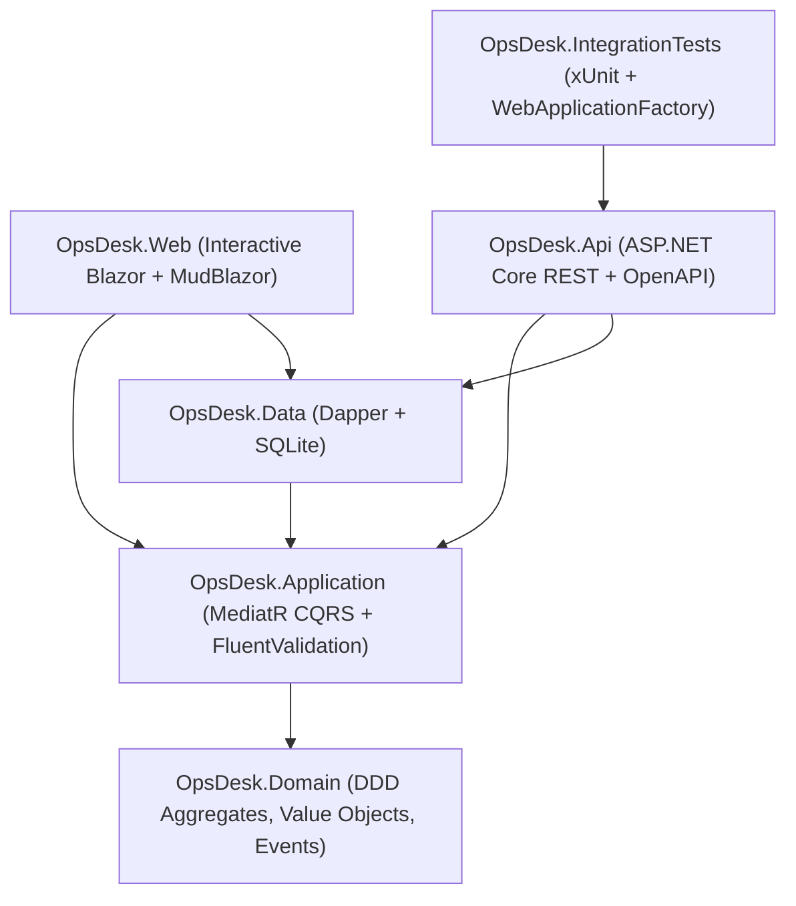

# OpsDesk

Enterprise IT & Operations Service Desk platform built with **.NET 10**, **Clean Architecture**, **DDD**, **CQRS (MediatR)**, **Dapper + SQLite**, and **MudBlazor** (`Obsidian & Emerald` theme).

---

## Architecture Overview



### Key Patterns & Design Highlights
- **Domain-Driven Design (`OpsDesk.Domain`)**:
  - `ServiceTicket` aggregate root enforcing lifecycle invariants (status transitions, specialist assignment, internal notes, technical reviews, and cross-team escalations).
  - Immutable Value Objects: `TicketId` (`OPS-2041`), `RequesterInfo`, and `SlaWindow` (business-day SLA calculation: `Urgent` = 1 day, `High` = 3 days, `Standard` = 7 days).
  - Strongly typed Domain Events (`TicketSubmittedEvent`, `TicketAssignedEvent`, `TicketStatusChangedEvent`, `TicketEscalatedEvent`).
- **CQRS & Validation Pipeline (`OpsDesk.Application`)**:
  - Command/Query separation via **MediatR**.
  - Cross-cutting `ValidationBehavior<TRequest, TResponse>` powered by **FluentValidation**.
- **Split Read/Write Persistence (`OpsDesk.Data`)**:
  - Aggregate write persistence (`TicketRepository`) paired with optimized Dapper read projections (`TicketQueryRepository`) over SQLite.
  - Automated schema initialization and demo seed data (`SchemaInitializer`).
- **MudBlazor UI (`OpsDesk.Web`)**:
  - Dark-mode **Obsidian & Emerald** `MudTheme` (`#0F172A` surface, `#10B981` primary accent, `ROUND_EIGHT` geometry).
  - Live **Persona Switcher** (`Operations Lead`, `Triage Lead`, `Specialist`, `Requester`, `System Admin`) in the top bar.
  - 9 operational views: Overview Dashboard, My Requests, Submit Service Request (with live SLA & routing preview), Split-Pane Triage Queue, Ticket Detail Workspace, All Tickets Directory, Reports & SLA Analytics, Admin & Role Management, and Notification Center.
- **End-to-End Integration Testing (`OpsDesk.IntegrationTests`)**:
  - Isolated SQLite `WebApplicationFactory<Program>` tests covering the full ticket lifecycle from submission through SLA calculation, triage, assignment, collaboration, technical review, escalation, resolution, and analytics reporting.

---

## Getting Started

### Prerequisites
- [.NET 10 SDK](https://dotnet.microsoft.com/download)

### Run the Blazor Web App (Standalone with Demo Seed Data)
```bash
dotnet run --project src/OpsDesk.Web
```

### Run the REST API & Swagger UI
```bash
dotnet run --project src/OpsDesk.Api
```

### Run Integration Tests
```bash
dotnet test OpsDesk.slnx
```
